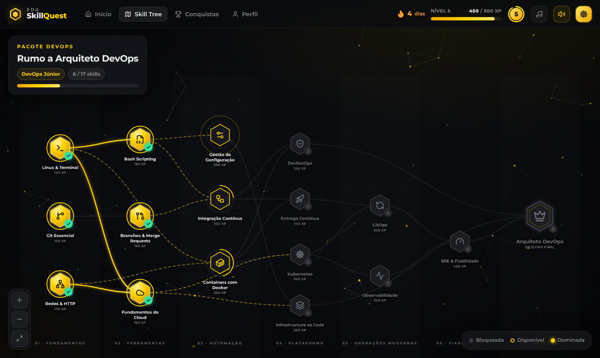

# EDA SkillQuest

Webapp de aprendizagem gamificada. O percurso é uma **skill tree** interativa que converge num objetivo final. Cada skill tem lições práticas e um desafio final: passa no desafio para desbloquear as skills seguintes. Pelo caminho ganhas XP, níveis, ranks e conquistas.

Vem com o pacote **DevOps** instalado. O objetivo final é *Arquiteto DevOps*.



## Funcionalidades

- **Skill tree** com pan, zoom e pinch. As ligações entre skills são animadas. Em ecrãs largos o layout é horizontal; em telemóvel passa a vertical.
- **Explorar o roadmap**: todas as skills, incluindo as bloqueadas, mostram uma descrição, os tópicos e os requisitos.
- **Lições** com terminal animado, código com destaque de sintaxe, diagramas de fluxo, tabelas comparativas, notas e verificações rápidas.
- **Desafio final** com perguntas aleatórias de quatro tipos: escolha única, escolha múltipla, ordenar passos e escrever um comando. Tem combo e cronómetro, e é preciso 80% para passar.
- **Gamificação**:
  - XP e níveis
  - ranks de carreira: Recruta → Júnior → Intermédio → Sénior → Arquiteto
  - marcos do roadmap e conquistas com raridade, algumas secretas
  - sequência de dias seguidos
  - certificado final
- **Som procedural** (Web Audio API, sem ficheiros de áudio): efeitos para cada interação e música ambiente generativa opcional.
- **Animações**: Framer Motion, um fundo "constelação" em canvas e confetti. As animações respeitam `prefers-reduced-motion`.
- **localStorage**: todo o progresso fica no browser, com exportar, importar e recomeçar no perfil.
- **Identidade EDA**: fonte Montserrat e cores #ffd200, #878787 e #ededed.

## Desenvolvimento

```bash
npm install
npm run dev      # http://localhost:5173
npm test         # valida a estrutura dos pacotes e a lógica de progresso
npm run build    # gera dist/ estático (pode ser servido de qualquer pasta)
```

O workflow `.github/workflows/deploy.yml` corre os testes e publica no GitHub Pages a cada push para `main`. Para isso, ativa *Settings → Pages → Source: GitHub Actions*.

## Criar um novo pacote

1. Cria `src/packs/<id>/` com um ficheiro por skill (ver `src/packs/devops/skills/*.ts`) e um `index.ts` que exporte um `Pack`.
2. Regista-o em `src/packs/index.ts`.
3. Corre `npm test`. Os testes validam:
   - ids únicos
   - dependências existentes e sem ciclos (sempre para tiers inferiores)
   - um único objetivo, alcançável a partir de todas as skills
   - índices de respostas válidos

O schema está documentado em `src/packs/types.ts`.

## Estrutura

```
src/
  packs/            conteúdo (schema + pacotes)
  lib/              estado (store + localStorage), progresso, conquistas, som, router
  components/       fundo animado, top bar, blocos de lição, overlays de celebração
  views/            início, skill tree, painel de skill, lição, desafio, conquistas, perfil
tests/              testes Vitest
```
